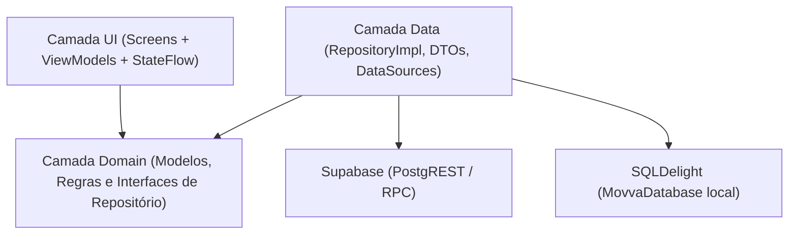

# Arquitetura do Movva

Este documento descreve a organização de camadas do aplicativo **Movva** (`shared/src/commonMain/kotlin/br/com/movva`), o fluxo de dados entre o backend e a interface, e as decisões técnicas adotadas para gerenciamento de estado e persistência local.

---

## 1. Visão geral em camadas

O código compartilhado entre Android e iOS vive no módulo `:shared` (`commonMain`) e segue uma separação em três camadas principais, com dependências apontando sempre para **`domain`**:

```text
  ui (Telas @Composable + ViewModel + StateFlow)
        │
        ▼
  domain (Entidades, Regras puras, Interfaces de Repositório)
        ▲
        │
  data (RepositoryImpl + RemoteDataSource + LocalDataSource + DTOs)
```



### Regras de isolamento do domínio
- Os pacotes `domain` contêm apenas modelos puros, validações e interfaces de repositório (`AuthRepository`, `PerfilRepository`, `TreinoRepository`, `DietaRepository`, `CheckInRepository`), além dos tipos de resultado (`PerfilResultado`, `TreinosResultado`, `DietasResultado`).
- O domínio **não importa** Compose, Ktor, `supabase-kt`, SQLDelight, Koin nem `kotlinx.serialization`. DTOs de serialização (como `ItemRefeicaoDto`, `TreinoDto`, `DietaDto`, `CheckInDto`, `PerfilDto`) ficam exclusivamente na camada `data`.

---

## 2. Caminho de um dado (Backend → Tela)

1. **Supabase (`PostgREST` / `RPC`)** responde aos `*RemoteDataSourceImpl` usando DTOs `@Serializable` na camada `data`.
2. **`*RemoteDataSourceImpl`** converte os DTOs para modelos de **`domain`**.
3. **`*RepositoryImpl`** coordena cache local (`*LocalDataSource`, via SQLDelight) e dados remotos:
   - Na leitura, emite rapidamente o cache local quando disponível e sincroniza pendências/dados atualizados do servidor.
   - Na escrita (treinos, exercícios, execuções, refeições, marcações e check-ins), grava primeiro no SQLDelight com `sincronizado = 0` e envia em seguida ao Supabase, marcando `sincronizado = 1`.
4. **`ViewModel`** (injetado via Koin recebendo a interface do repositório pelo construtor) executa as operações no `viewModelScope` e publica o estado em um **`StateFlow`** imutável (mantendo o `MutableStateFlow` privado), modelado por **`sealed interface`** (`Carregando`/`Loading`, `Vazio`, `Sucesso`/`Dados`, `Erro`).
5. **Tela `@Composable`** lê o estado via **`collectAsStateWithLifecycle()`**, decide a renderização com `when (state)` exaustivo (sem `else`) e delega intenções do usuário chamando funções do `ViewModel` em um componente stateless (`*Content`), permitindo `@Preview` de todos os estados e testes isolados.

---

## 3. Divisão `components` e `feature` (além de `auth` e `core`)

O projeto mantém dois agrupamentos funcionais em `br.com.movva` com a mesma estrutura interna (`domain`, `data`, `ui`, `di`):

- **`components/` (`perfil`, `treino`, `dieta`):** módulos de domínio centrais e reutilizáveis que formam a base do produto e são consumidos por mais de um fluxo (ex.: `DietaRepository` e `TreinoRepository` são usados tanto nas suas próprias abas quanto no resumo da Home e no check-in).
- **`feature/` (`checkin`, `home`):** fluxos orientados à jornada principal do app e à orquestração entre domínios — `checkin` calcula a sequência diária (*streak*) com base em atividades de treino/dieta, e `home` agrega a visão resumida do dia e as ações rápidas para as demais abas.
- **`auth/` e `modules/`:** fluxo de autenticação (`AuthGateViewModel`, `LoginViewModel`, `LoginScreen`, `AuthRepository` em `auth/domain` e `AuthRepositoryImpl` em `auth/data`) e registro do módulo `authModule`.
- **`core/`:** peças compartilhadas de infraestrutura e UI (`theme/MovvaTheme.kt`, `navigation/MainScreen.kt` e `MovvaNavBar.kt`, `network/SupabaseModule.kt`, `db/DatabaseDriverFactory`, `clipboard/ClipboardManager`, `util/DataUtil`, e componentes visuais `BotaoPrincipal`, `BotaoTracejado`, `CampoTexto`, `EscopoDeTela`, `Selo`).
- **`components/BlankScreen.kt`:** tela placeholder usada exclusivamente pela aba `Aba.DESAFIOS`, reservada para as funcionalidades futuras de desafio em grupo (`MOV06`–`MOV09`, fora do escopo do MVP conforme [`docs/sprint-0/proposta.md`](sprint-0/proposta.md)). Por não exibir dados dinâmicos, não possui `ViewModel`.

*(A divisão entre `components` e `feature` foi preservada intencionalmente para manter estabilidade entre entregas paralelas da equipe.)*

---

## 4. Injeção de dependências (Koin)

Cada módulo registra suas implementações, datasources, repositórios e `ViewModel`s em um arquivo `di/`:
- `supabaseModule` (`core/network/SupabaseModule.kt`)
- `platformModule()` (`core/di/PlatformModule.*.kt` — `DatabaseDriverFactory` e `ClipboardManager`)
- `authModule` (`modules/AuthModule.kt`)
- `perfilModule` (`components/perfil/di/PerfilModule.kt` — inclui `SqlDriver` e `MovvaDatabase`)
- `treinoModule` (`components/treino/di/TreinoModule.kt`)
- `dietaModule` (`components/dieta/di/DietaModule.kt`)
- `checkInModule` (`feature/checkin/di/CheckInModule.kt`)
- `homeModule` (`feature/home/di/HomeModule.kt`)

Parâmetros de rota (como `treinoId` em `TreinoDetalheViewModel` e `RegistrarRefeicaoArgs` em `RegistrarRefeicaoViewModel`) são passados via `parametersOf(...)` dentro de `EscopoDeTela`, garantindo descarte do estado ao sair da tela de detalhe/edição.

---

## 5. Justificativas das escolhas técnicas

### Por que `ViewModel` multiplataforma + `StateFlow` + `sealed interface`?
- **Reatividade e ciclo de vida:** o `StateFlow` expõe sempre o estado atual imutável, sobrevive a recomposições e mudanças de configuração quando associado ao `ViewModel`, e é coletado com segurança pelo ciclo de vida usando `collectAsStateWithLifecycle()`.
- **Estados explícitos sem `else`:** modelar `Loading`/`Carregando`, `Vazio`, `Dados`/`Sucesso` e `Erro` com `sealed interface` impede estados impossíveis (como "carregando e com erro ao mesmo tempo") e faz o compilador garantir que todos os estados sejam tratados na UI.
- **Alternativa descartada:** manter estado de negócio em `remember { mutableStateOf(...) }` dentro de `@Composable` acoplava lógica à UI, dificultava testes unitários e espalhava regras entre telas.

### Por que SQLDelight para persistência local?
- **Multiplataforma real (Android e iOS):** `AndroidSqliteDriver` no Android e `NativeSqliteDriver` no iOS compartilham exatamente o mesmo schema SQL, queries e migrations (`shared/src/commonMain/sqldelight/.../*.sq` e `*.sqm`).
- **Modelo relacional e fila de sincronização:** as entidades do Movva (`treinoEntity`, `exercicioEntity`, `execucaoTreinoEntity`, `dietaEntity`, `refeicaoFeitaEntity`, `checkInEntity`, `perfilEntity`, `sessaoEntity`) exigem consultas por usuário, data e chave composta, além de flags `sincronizado` para reenvio offline-first.
- **Alternativas descartadas:** `DataStore` / `SharedPreferences` não oferecem consultas relacionais nem chaves compostas adequadas para histórico de treinos/dietas/check-ins; `Room` adicionaria maior complexidade de configuração KMP no setup inicial com iOS quando comparado ao SQLDelight.
